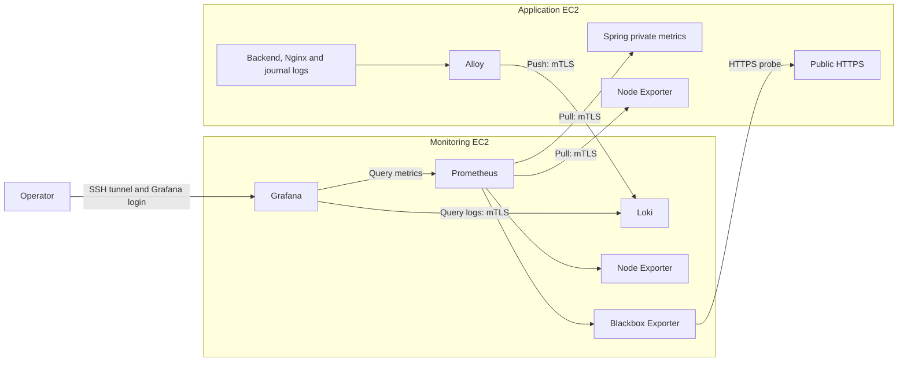

# Private monitoring on a dedicated EC2

- Status: Accepted
- Date: 2026-11-27
- Scope: TheEverThread production telemetry
- Authority: The project owner's selected two-EC2 architecture and subsequent
  approval of direct mTLS scrapes and centralized logs.
- Baseline consulted: `851bb25cf3fd9c09724a3af74dc419479bbbc229` (`origin/main`).

## Context

The application needs host health, Spring/JVM/HTTP measurements, public HTTPS
checks, and searchable backend, Nginx and operating-system logs. The owner chose
self-hosted Grafana and Prometheus with a dedicated monitoring EC2, dashboard
access only, and a constrained initial instance with about 2 GiB RAM.

## Decision

Keep telemetry storage and visualization on the monitoring EC2. Prometheus
pulls metrics directly from the application host; Alloy on the application host
collects logs and pushes them to Loki. Grafana queries the two stores. Do not
insert an additional metrics gateway or application ingestion-token scheme.

Node Exporter runs on both hosts and reads host information through restricted
read-only mounts. Same-host metric collection uses the internal Docker network.
Cross-host listeners bind to private host interfaces, with security-group access
restricted to the communicating host's security group. Grafana binds to host
loopback; Prometheus, Blackbox and Alloy expose no public host listeners.

Spring retains normal HTTP 8080 and its existing health checks. An optional
8443 connector requires mTLS and permits only the designated Prometheus client
identity to GET `/actuator/prometheus`; it denies other routes. The application
host exporter uses 9100. Loki natively requires mTLS on private port 3100; its
single-tenant setting does not disable transport authentication.

Use the existing private telemetry CA. The application server identity covers
its private IP and is shared by Spring and Node Exporter. Prometheus, Alloy and
Grafana's log query path have separate client identities. Loki has a server
identity covering its private IP and internal Docker DNS name. The CA signing
key stays on monitoring, outside containers and Git. Leaf validity is 90 days.

Loki's transport policy trusts client certificates from that CA; it does not
provide separate ingestion/query roles or enforce client common names. Spring
adds an explicit identity authorization check. Do not describe these as equivalent
authorization boundaries. A private network does not replace certificate checking.

Alloy follows application containers using stable Compose labels and reads the
persistent host journal. It groups Spring stack traces and uses bounded source
labels rather than request identifiers. Its Docker API socket access is powerful,
even with a read-only mount: treat the collector as a trusted host component.

Version Compose, service configuration, provisioning templates and verification
commands in the application repository under `deploy/aws/monitoring`. Generate
private credentials and secret-bearing Grafana provisioning only under ignored
host-local `runtime/`. Store telemetry in persistent named volumes.

Application image deployment and host configuration synchronization are separate.
The GitHub pipeline invokes the installed application deployment script through
SSM; this does not synchronize monitoring files. Operators currently maintain
monitoring and collectors through SSH. The application deployment script retains
the Spring overlay when its host-local enablement marker exists.

## Consequences and limits

- The monitoring host can observe application failure independently, but remains
  a single failure domain itself. No telemetry replication or off-host backup is
  established by this decision.
- Start with 30-second scrapes, seven-day/5 GB historical metric retention, and
  72-hour log retention. Loki filesystem retention is asynchronous, not a disk
  quota. Measure memory, disk and ingestion before increasing load.
- Alloy reads recent history, keeps source positions, and retries failed batches.
  It currently has no durable outgoing WAL. Extended outages, rotation and
  exhausted retries can lose logs; this is not an audit-log durability guarantee.
- Logs retain original contents. Access-log URLs and addresses are not indexed
  as labels, but remain in log text. Keep dashboard access private.
- A successful metric scrape is not application readiness. A successful scrape
  of Blackbox's report is not a successful website probe; inspect `probe_success`.
- Certificate renewal is currently an operator procedure. Update all dependent
  mounts and Grafana provisioning after rotation. Automation, revocation handling
  and backup procedures remain operational follow-up work.
- Notification delivery is outside the accepted dashboard-only scope.

## Implementation references

The [application repository](https://github.com/Samehadel/theeverthread) contains
the Compose files, `prometheus.yml`, `loki.yml`, `alloy.alloy`, certificate helpers,
Grafana provisioning and repeatable smoke checks. Its monitoring `README.md`
is the operational runbook and `TUTORIAL.md` explains the setup for a new operator.
